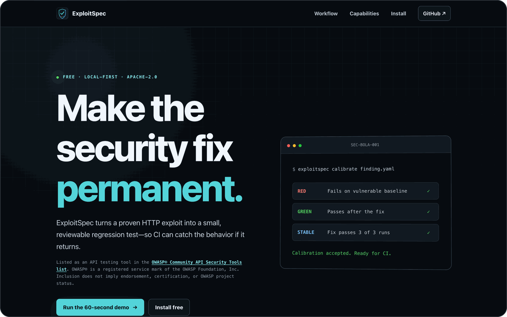
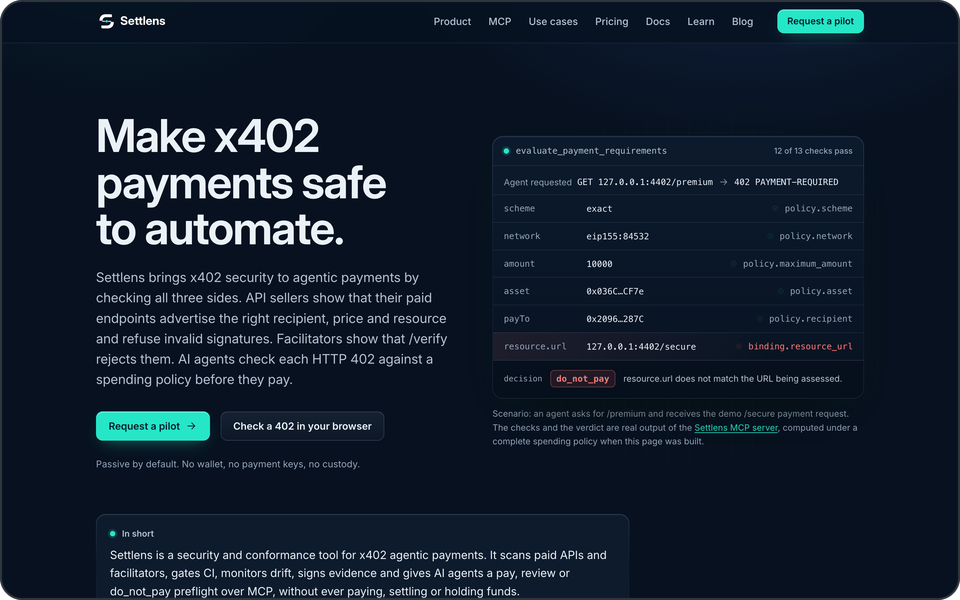
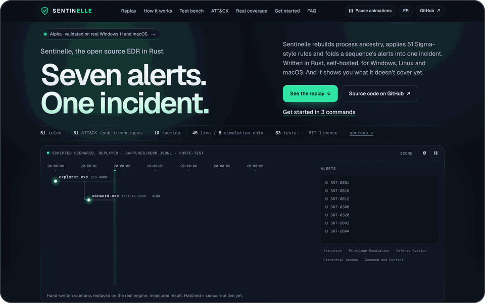
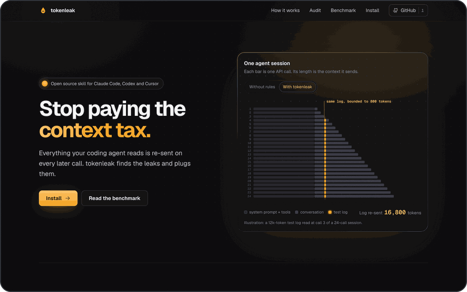
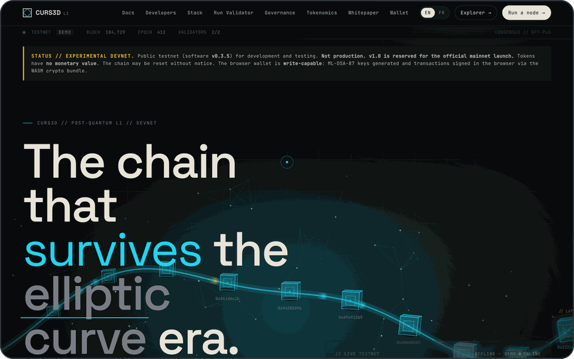
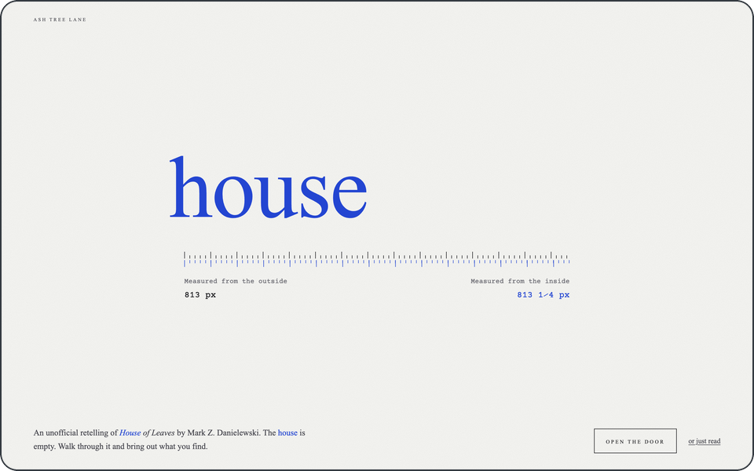
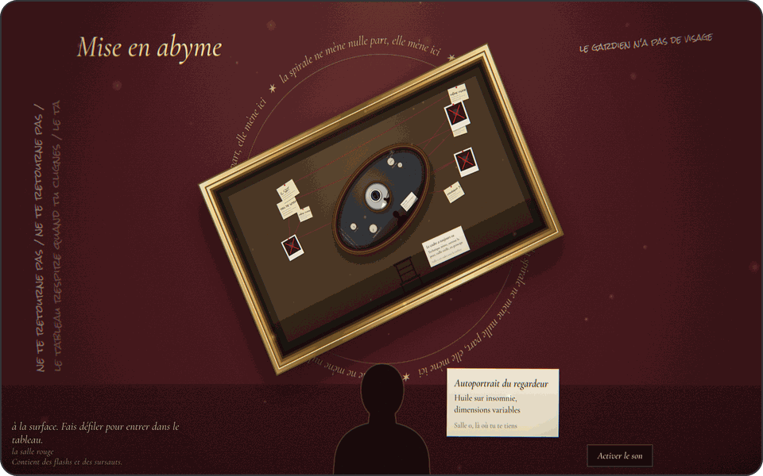

<picture>
  <source media="(prefers-color-scheme: dark)" srcset="assets/hero-dark.svg">
  
</picture>

I find vulnerabilities, fix them in production, then turn the proof into a test so the bug can't quietly come back. Work-study at a web agency in Lyon, where I look after the security of the client apps and servers, alongside a Master's in cybersecurity.

[Email](mailto:alessandro.gagliardi225145@gmail.com) · [LinkedIn](https://www.linkedin.com/in/alessandro-cyber/) · [CV](https://pazificateur69.github.io/showreel/en/) · [Portfolio](https://pazificateur69.github.io/)

## ExploitSpec

A pentest report goes stale the day it's delivered. [ExploitSpec](https://github.com/pazent/exploitspec) keeps the proof next to the code: you describe the actors, replay the exploit's HTTP requests and assert what the fix must guarantee. The test fails on the vulnerable build, passes on the fixed one, and runs in CI from then on.

Go CLI and [GitHub Action](https://github.com/marketplace/actions/exploitspec-security-regression-tests) · listed in [OWASP's API security tools](https://owasp.org/www-community/api_security_tools) · Homebrew, winget and a [Burp Suite bridge](https://github.com/pazent/exploitspec-burp) · Apache-2.0

## Other tools

<table>
<tr>
<td width="50%" valign="top">

<h3><a href="https://settlens.com">Settlens</a></h3>
Security checks for x402 agent payments. Validates the HTTP 402 handshake, flags price or recipient drift, enforces a spending policy and confirms that a forged signature fails closed. Never touches funds or keys.
  
JavaScript · CLI, CI and MCP tools · <a href="https://github.com/Pazificateur69/settlens">source</a>
</td>
<td width="50%" valign="top">

<h3><a href="https://github.com/Pazificateur69/sentinelle-edr">Sentinelle</a></h3>
Open-source EDR in Rust. 51 Sigma-style rules across 10 ATT&amp;CK tactics, process-ancestry correlation that folds an attack chain into one incident, a live SOC console and an agent fleet over gRPC with mTLS. ETW sensor validated on a real Windows 11.
  
Rust · alpha · <a href="https://pazificateur69.github.io/sentinelle-edr/en/">replay an attack</a>
</td>
</tr>
<tr>
<td width="50%" valign="top">

<h3><a href="https://github.com/Pazificateur69/tokenleak">tokenleak</a></h3>
Reads your own Claude Code and Codex transcripts and shows where the tokens went, then ships ~770 tokens of rules that plug the leaks. Cut cost by 32% across 80 A/B benchmark runs on Sonnet 5.
  
Python · zero dependencies · <a href="https://pypi.org/project/tokenleak/">PyPI</a>
</td>
<td width="50%" valign="top">

<h3><a href="https://github.com/Pazificateur69/curs3d">CURS3D</a></h3>
A post-quantum Layer 1 written from scratch in Rust. ML-DSA-87 (FIPS 204) signatures, BFT proof of stake, WASM and EVM sharing one state trie, MetaMask-compatible RPC. Deployed as a 5-validator testnet on 4 hosting providers.
  
Rust · experimental, unaudited · <a href="https://curs3d.fr/whitepaper.html">whitepaper</a>
</td>
</tr>
</table>

## Merged upstream

- **[OWASP/www-community](https://github.com/OWASP/www-community/pull/1316)**: ExploitSpec added to the API security tools list.
- **[elder-plinius/T3MP3ST](https://github.com/elder-plinius/T3MP3ST/pulls?q=is%3Apr+author%3APazificateur69+is%3Amerged)** (6k+ ★): 5 PRs that make its arsenal call real scanners, parse their output into verifiable findings and gate every claimed solve on an oracle.
- **[Cloeille/picsou-finance](https://github.com/Cloeille/picsou-finance/pulls?q=is%3Apr+author%3APazificateur69+is%3Amerged)** (500+ ★): 4 fixes, including third-party payloads leaking into logs and an unchecked encryption key length.
- **[microsoft/winget-pkgs](https://github.com/microsoft/winget-pkgs/pull/422343)**: ExploitSpec packaged for Windows.

## Day job

<picture>
  <source media="(prefers-color-scheme: dark)" srcset="assets/stats-dark.svg">
  
</picture>

- **Audits**: white-box and dynamic, scored with OWASP, CWE and CVSS. 45 findings on an Angular/Laravel SaaS, 31 on a Next.js CRM, 52 of 53 fixed on a mobile app.
- **Pipeline**: a gate on every push with Semgrep, Trivy, Gitleaks and OWASP ZAP, a CycloneDX SBOM, Cosign signatures and distroless, non-root images.
- **Servers**: key-only SSH, ModSecurity with OWASP CRS in blocking mode, CrowdSec and Fail2ban, 7 Docker ports pulled off the internet, 9 kernel CVEs patched live. A `/.env` inclusion attempt contained, then blocked on 15 domains.
- **Bug bounty**: 2 high-severity findings accepted at a telecom operator on YesWeHack.

## After hours

<table>
<tr>
<td width="50%" valign="top">

<h3><a href="https://pazificateur69.github.io/ash-tree-lane/">Ash Tree Lane</a></h3>
<i>House of Leaves</i> as a house you walk through. Three.js, sound placed around your head, and a journal that fills as the house grows. A reader's tribute to Danielewski.
</td>
<td width="50%" valign="top">

<h3><a href="https://pazificateur69.github.io/mise-en-abyme/">Mise en abyme</a></h3>
An endless descent through paintings hung inside paintings. It never loops. In French.
</td>
</tr>
</table>
